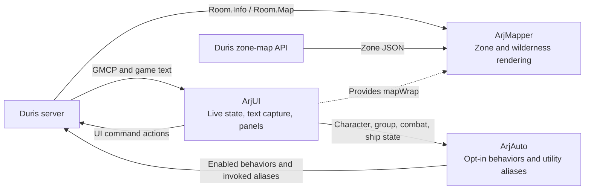

# Duris client design

The Duris client is a Mudlet package built around a central game console,
persistent room and combat information, and a restrained dark-fantasy frame.
This document describes its interface, visual conventions, and runtime
architecture so changes can preserve a coherent experience.

The implementation lives in [`src/`](../src/). Layout and style definitions are
in [`ArjUI.lua`](../src/scripts/ArjUI.lua), map rendering in
[`ArjMapper.lua`](../src/scripts/ArjMapper.lua), and opt-in automation in
[`ArjAuto.lua`](../src/scripts/ArjAuto.lua). Update this document when those
design decisions change. Player commands are documented in the
[README](../README.md#commands); verification procedures are in the
[Linux development guide](LINUX_DEVELOPMENT.md).

## Design priorities

- **Keep game text central.** The main output receives most of the width,
  wraps to its available space, and uses an opaque black background.
- **Keep frequently needed state visible.** Room contents, exits, vitals,
  target, and chat have stable locations. Less urgent character information
  shares a tabbed panel.
- **Use decoration around the information.** Dark metal and bronze establish
  the fantasy setting; strong color belongs to status, warnings, and actions.
- **Preserve familiar input.** Mudlet's native command line supplies command
  history, completion, and focus. Clickable controls send ordinary game
  commands alongside keyboard input.
- **Scale the layout while protecting readability.** Major regions use
  percentages; long output wraps and large groups scroll inside their panel.
  Fonts and some controls have fixed sizes and need visual checks at each
  supported geometry.
- **Make automation opt-in.** ArjAuto's behavior toggles start off on a fresh
  profile. Saved choices persist; repeated-command timers have explicit
  start/stop commands.

## Interface layout

`ArjUI:init()` creates a full-window background and a transparent UI container.
The content root is inset **2.5%** from each side and leaves **2.8%** at the
bottom. In full mode (the default), it starts **10.5%** below the top and is
**86.7%** tall. `ui set compactHeader on` moves its top to **2.8%** and makes
it **94.4%** tall. Width stays **95%** of `getMainWindowSize()` in both modes.
The root gains **7.7%** of the logical window height; game output gains height according to the selected
panel arrangement.
`ArjUI:headerHeightPct()` supplies the same decision to startup and
`ArjUI:layout()`, which recalculates the root/footer and redraws the active
map from current-session data on header changes, show, and resize.
When `mapper off` pauses updates, those layout changes retain the displayed
map; they must not render the incoming GMCP payloads ignored by the mapper.

Ten `Adjustable.Container` frames are siblings under the content root. The
package owns one descriptor list for geometry, minimum logical sizes and reset.
Panels default to locked, visible and docked. A title drag or border resize
floats a panel; Dock returns its named home rectangle. Native border attachment
and frame auto-save/load are disabled. Frame content uses a 22px title band and
5px side/bottom clearance. Titles replace duplicate mobs/items/players headers.

Default rectangles (x, y, width, height as percentages of the content root):

- Map: (0, 0, 16.5, 32), including area/world links, exits and time.
- Mobs: (0, 33, 16.5, 21.5); items: (0, 55.5, 16.5, 23.5).
- Output: (16.7, 0, 57, 79), including experience and room title.
- Character: (73.9, 0, 26, 45); players: (73.9, 46, 26, 26);
  chat: (73.9, 73, 26, 27).
- Vitals: (0, 80, 16.5, 19.5); tank: (16.7, 80, 28.3, 19.5);
  target: (45.5, 80, 28.2, 19.5).

The bottom strip is slightly taller to preserve combat labels below the new
frame controls. Names/positions use 16px, HP uses 16px, affects headers 14px;
remaining height is for affects. Character/chat tab rows retain an 18px minimum.
Minimum full sizes are map 190x170, mobs/items 150x95, output 340x180,
character 285x160, players 190x95, chat 285x110, vitals 150x110 and
tank/target 220x110, in Qt logical pixels. Smaller viewports clamp displayed
rectangles to available space without replacing saved normal rectangles.

The fixed Panels and Reset layout controls sit just above the root inside the
existing header margin. They remain outside maximized frames. Footer credits
stay below the right column; native command input stays available. Auxiliary
frames support hide/minimize, every dashboard frame supports maximize/restore
and global/per-panel locking. Game output cannot hide/minimize independently.
The common command dispatcher enforces the same capabilities as title menus.
Existing tell conversations appear in the scrollable Panels menu even before
first opening. `tell:<name>` frames use the same owner, start unlocked/floating
at 300x220 (minimum 260x160), and remain session-only. Their console and input
sizes follow the inner frame, preserving drafts/history across full reset.
Parent show reconciles active character/chat/map views without switching tabs
or sending commands. Map viewport refresh coalesces through one owned timer,
redraws accepted zone/wilderness data, and performs no network request.
A maximized frame hides all other dashboard frame trees without changing their
saved normal state. Map event/deferred renderers use the same effective body
visibility rule, continue accepting room data while covered, and redraw on reveal.
Maximizing a map overrides its saved hidden/minimized state for redraw; restoring
returns to that normal state. Private conversations use the same visibility rule:
unread counts clear only when the frame body is actually revealed, and repeated
layout passes or covered open requests cannot acknowledge unseen messages.

The character tabs are **GROUP / STATS / INV / EQ / WHO / SHIP**, with GROUP
selected initially. Chat has **ALL / TELLS / NCHAT / ROOM / GUILD / GROUP**,
with ALL selected initially. STATS includes identity, coins, and bartender
quest information. SHIP is a narrow, scrollable text view ordered by identity
and navigation, Condition, Weapons, Crew and supplies, Equipment, Cargo, then
Contacts sorted by range. Condition lists Forward/Port/Starboard/Rear armor
and hull current/max values, plus sail; red/amber/green accents supplement
the labels. Unknown or zero maxima stay neutral. Weapons sort by numeric slot
with named entries and separate position, ammo, damage and timer readiness;
a ready timer does not imply a usable weapon. Crew skills remain integers
with separate signed modifiers, and cargo capacity is labeled in crates.
Known empty lists show None; absent fields stay unknown or are omitted.
Server/text colors are stripped from names. Updates preserve the reader's
scroll position. GMCP facts take precedence over the smaller text fallback;
bridge departure clears the display. Weight, set orders and exact reload
timers are absent from the inspected GMCP contract and are not inferred.

The bottom strip puts HP, MP, movement, and position below the left column.
Tank and target displays split the space below the console. **BUFFS and
DEBUFFS both describe the player's affects**, even though they sit below the
tank and target respectively. DMG shows the current fight's damage total.

## Visual language

### Frame and surfaces

[`src/assets/duris-v1.png`](../src/assets/duris-v1.png) is the installed frame.
Its art direction uses obsidian iron, worn bronze atlas/compass engravings,
and a single DURIS wordmark. Keep ornament in the top band and perimeter,
outside the content-root bounds. The frame stretches to the window, so review
both its lettering and its alignment at different aspect ratios. The
[artwork record](artwork/duris-frame.md) contains its generation prompts.

`ArjUI:applyBackground()` locates the installed asset in full mode and uses a
dark gradient when it is unavailable. Compact mode intentionally uses that
gradient without the frame/wordmark, leaving the bronze panel chrome in place.
Changing the setting repaints and resizes existing widgets. It retains output,
tabs, chat, character state, and map cache/zoom, and keeps a hidden UI hidden.
Primary output has its own opaque black panel, so
artwork cannot show through the game feed. Secondary panels use warm dark
surfaces and softer borders. The
[README header](assets/header-prompt.md) is separate illustrative artwork;
it is not a screenshot or the in-client frame.

The main palette is defined in `ArjUI:init()` as `colors`, `styles`, and
`gaugeStyles`. Some component styles are defined in their render functions;
there is no external theme file.

| Role | Current values | Use |
| --- | --- | --- |
| Main feed | `#000000` | Console and surrounding center panel |
| Warm surfaces | `#0a0908`, `#0f0e0c`, `#16140f` | Panels, gradients, headers, active tabs |
| Auxiliary console/map surface | `#0c0b09` | Lists and map background |
| Primary/secondary borders | `#8c6e46`, `#5a4b37` | Bronze edges and panel hierarchy |
| Dividers/subtle edges | `#3c3832`, `#2a2520` | Internal separation |
| Text hierarchy | `#8a8a8a`, `#b0b0b0`, `#e6e6e6` | Dim, medium, and bright text |
| Semantic accents | Gold `#d4a855`, red `#c45050`, green `#50c070`, blue `#7090c0` | Target/information, combat, affects, navigation |

Primary panels generally use 2 px borders and 4 px corner radii; secondary
panels use 1 px borders. Active tabs use brighter text and a stronger top edge.
Keep hover treatments consistent with the control's action and state.

HP, mana, movement, and experience gauges use red, blue, green, and purple
respectively; the target gauge uses gold. Health-dependent tank/group colors
also communicate severity. Retain numeric values, labels, and state markers
alongside color: non-mana characters show **MP n/a**, absent group members show
**AWAY**, and NPC group members retain a trailing `*`.

### Typography and density

The main MiniConsole is configured with `fontSize = 10`; list/chat consoles
use 9 and affect consoles use 8. Label styles commonly use 9–12 px, with
smaller tab labels. MiniConsole font sizes and Qt stylesheet pixel sizes are
separate settings. The wilderness map explicitly requests Consolas; available
fonts and substitution depend on the platform.

Percentage geometry does not guarantee readable text at every window size or
DPI. Preserve wrapping in text consoles and scrolling in GROUP instead of
shrinking rows to fit an arbitrarily large group. Group rows currently use a
38 px height with 4 px spacing; shortened names have full-name tooltips.
Check room/area names, crowded groups, long messages, symbols, and tabs in
real Mudlet when changing fonts or measurements.

## Interaction conventions

| Control | Behavior |
| --- | --- |
| Exit label | Sends the corresponding direction. Closed and locked doors receive distinct styles. |
| World icon / area name | Opens the world map / current zone's wiki page. |
| Time display | Sends `time`. |
| Character tab | Selects its view; clicking the active STATS, INV, EQ, WHO, or SHIP tab requests `score`, `inv`, `eq`, `who`, or `look contacts`. |
| Entity link / group member | Opens contextual actions; custom actions are saved by category. |
| TELLS contact | Opens a private conversation window; unread counts mark new messages. |
| DMG | Prints the session damage report. |
| Map + / − | Changes zone room size or wilderness text zoom according to the current mode. |
| `ui off` / `ui on` | Hides/shows the existing interface while retaining its state and widgets. |

Hiding the UI restores Mudlet's main output area. It does not unload the
package or turn off enabled automation. The native command line stays
available in either view.

Chat routes `gcc` to GUILD, `gsay` to GROUP, `jchat` with `nchat` to NCHAT,
and room speech to ROOM; ALL collects the channels. TELLS provides contacts
and individual conversation windows. `petition` and `wizmsg` have distinct
colors in ALL. Timestamps and numpad movement are enabled by default and can
be disabled with `ui set`; see the [command reference](../README.md#commands).

## Runtime architecture

The package uses Mudlet's Lua runtime, Geyser widgets, Qt stylesheets, and the
built-in JSON facilities. It adds no external Lua dependencies. Geyser owns
geometry; widget styles define appearance.

`ArjUI` owns the interface and normalized live state. GMCP handlers update
state and render affected panels; text triggers fill gaps in the protocol.
While the UI is visible, its routing trigger copies game lines into the
central MiniConsole and removes them from the underlying main console.

`ArjMapper` mounts its widgets inside `ArjUI.mapWrap` and subscribes directly
to room/map events. `ArjAuto` owns its aliases, triggers, keys, and timers;
it reads ArjUI state to decide when an enabled behavior may act. ArjUI also
hands scan summaries to automation and resets its pending actions on session
changes. ArjAuto's saved login commands use its own game-text triggers.

### Data sources

| Input | Used for |
| --- | --- |
| `Char.Vitals` | HP/mana/movement, experience, position, coins, fighting state, mana applicability |
| `Char.Status` | Identity and character-entry detection |
| `Char.Affects` | Player buffs/debuffs, classified locally by name |
| `Room.Info` | Room/area, exits and doors, mobs/items/players, zone and position |
| `Room.Map` | Server-colored wilderness map |
| `Group.Status` | Membership, capacity, HP/movement, positions, NPC and away markers |
| `Combat.Update` | Target and optional damage rounds; explicit null ends the target display |
| `Comm.Channel` | Chat routing, incoming/outgoing tells, sender alignment when supplied |
| `Quest.Status` | Bartender quest display; `remaining` means quests still available today |
| `Ship.Info` / `Ship.Contacts` | Ship details, heading/speed, contacts, allegiance and target lock |
| Game text and prompts | Tank condition, time, inventory/equipment/who captures, ship fallback, scan and alert helpers |
| HTTPS zone-map JSON | Zone nodes/edges used to construct local map views |

ArjUI identifies the client/version with `Core.Hello` and advertises the
eleven consumed GMCP packages with `Core.Supports.Add`. UI login detection
primarily uses `Char.Status`; a default prompt pattern is a fallback.
Text-dependent panels still depend on recognized server output.
Inventory/equipment captures also recognize Telnet prompt boundaries,
including custom prompts.

Damage tracking prefers `Combat.Update.round`. The text fallback reads
`[Damage: N]`; once GMCP rounds have been observed, late text must not count
the same damage again. Tank identification/condition depends on prompt text;
the self-tank display uses the player's vitals.

For exact protocol examples, use the checked-in
[server serializer fixtures](../tests/mudlet/fixtures/server-gmcp.json) and
their [provenance](../tests/mudlet/fixtures/README.md). The
[connection audit](ongoing-projects/mudlet-local-testing.md#133-connection-audit--2026-10-14)
records the later contract fixes; the
[original server study](ongoing-projects/updates-upgrades.md) is historical.

### Map behavior

Zone layouts come from `https://duris.sbs/api/wiki/zones/{zoneId}/map-data`
and are cached in memory. The mapper builds a local room view around the
current position. Bronze rooms/passages, a coral player marker, door colors,
and up/down indicators distinguish navigation features. Room hover labels
show identifying information within the map's bounds; decorative markers
allow mouse events to reach the rooms below them.

Wilderness uses the server's `Room.Map` text and Duris color codes:
`&=XY` sets background X and foreground Y, `&+X` sets foreground X and clears
the background, and `&-X` sets background X with default foreground. Colors
reset on newlines, explicit resets and each map update so terrain backgrounds
stay with their intended cells. The map retains its muted background palette.
The map's zoom
buttons affect its text size in this mode. In zone mode, buttons adjust room
size from 8 to 24; the separate `mapper size` command accepts 8–20.

A zone request has a 15-second timeout and cleans up its temporary file and
download handlers. Invalid or failed responses report an error; a previous
zone must not remain displayed as the new one. Delayed zone downloads must
not replace a newer wilderness view. `mapper reload` clears the cache; move
or use `look` to obtain fresh room data and retry.

## State, persistence, and lifecycle

| Storage | Contents and lifetime |
| --- | --- |
| `arjui_layout.json` | Versioned dashboard modes, normalized normal rectangles, locks and hidden/minimized flags; maximize is transient |
| `arjui_settings.json` | Seven display/input toggles: `compactHeader` defaults off; the other six default on |
| `arjui_custom_commands.json` | Custom context-menu actions |
| `arjauto.json` | Automation toggles, variables, rescue list, bidscores, and login commands |
| Memory | Character state, captures, damage counters, chat/contact history, map cache and current location |

JSON files live under the active Mudlet profile directory returned by
`getMudletHomeDir()`. Chat/contact history is not written to disk and remains
available across a connection reset within the loaded UI. UI teardown/profile
restart clears it. Saved settings are separate from live character state.
Settings load before background and geometry construction. A profile without
`compactHeader` retains full mode; compact mode persists across reinstall and
profile restart.

On account-menu return, disconnect, or a new connection, character/combat,
group, quest, capture, ship, and current-map state is cleared, and pending
actions are canceled. Preferences and in-memory chat remain. Map downloads
and delayed actions must not apply to the next character session.

Each script tracks the runtime resources it creates. Package uninstall calls
the three cleanup paths to remove aliases, triggers, keys, handlers, timers,
and widgets. New callbacks or delayed work must join the owning script's
cleanup path. Hiding the UI is a separate operation from teardown. Layout reset never calls
`init()` or `kill()`, never sends game commands, and preserves scrollback and
preferences. Gesture completion saves once; ordinary window resizing clamps
only the displayed geometry. Missing/corrupt/unsupported layouts fall back to
defaults with local diagnostics. Writes use a temporary file plus replacement.

## Packaging and design validation

[`build.py`](../build.py) fills the three Lua placeholders in
[`src/package.xml`](../src/package.xml), injects `VERSION` into packaged
metadata and `ArjUI.VERSION`, validates XML, and copies assets into the
`.mpackage`. Edit sources and rebuild; never hand-edit the archive. Repository
documentation is not packaged and does not need a version bump. Package
changes follow [RELEASING.md](RELEASING.md).

For a visual or behavioral change, build the candidate, run
`python3 scripts/mudlet_suite.py`, and inspect its real Mudlet screenshots and
Errors view. Record visual review with the controller's `review` command.
`build.py --check` covers Lua syntax only, and an automated suite pass does
not establish appearance.

Use the focused scenarios and geometry commands in the
[Linux guide](LINUX_DEVELOPMENT.md#automated-offline-tests) to review the
affected surfaces. The scenario registry includes **1280×720, 1366×768, and
1920×1080**, plus a scale-2 geometry of **2732×1536**; a default suite run is
not the full size/scaling matrix. Check long text, crowded groups, empty and
critical states, map transitions/hover, keyboard and mouse controls, and
hide/show/reconnect behavior as relevant to the change.

The offline controller requires Mudlet **5.0+**. The package's declared
minimum **4.19.1** and physical-desktop font/DPI behavior need separate
verification. Live-server checks use a separate profile. Keep evidence and
coverage limits in the [testing log](ongoing-projects/mudlet-local-testing.md).

## Current boundaries

The layout has no breakpoint-driven column rearrangement or editable theme
system. SHIP displays text rather than a graphical radar. `Quest.Map` and
structured `Comm.Channel.presentation` color runs are not rendered. Room
player alignment coloring is limited by the fields the server supplies, and
affect classification uses name patterns rather than a server-provided
buff/debuff flag.

The imported LuminariGUI references are background material for a different
package. Their fragment build system, MSDP setup, `GUI.*` helpers, and release
checklists do not define this client's design; see the
[documentation index](README.md#imported-reference-material).

Layout saves first try atomic replacement, then retain a backup while replacing
an existing Windows destination. Failed installation restores the old file;
startup can read the backup after interruption. Dashboard-only recovery lists
ten registered groups; private frame integration is delivered by PR #12.
