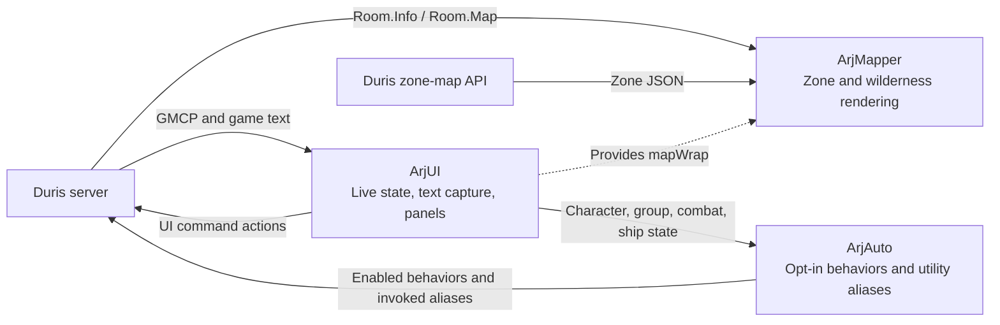

# Duris client design

The Duris client is a Mudlet package built around a central game console,
persistent room and combat information, and a restrained dark-fantasy frame.
This document describes its interface, visual conventions, and runtime
architecture so changes can preserve a coherent experience.

The implementation lives in [`src/`](../src/). Layout and style definitions are
in [`ArjUI.lua`](../src/scripts/ArjUI.lua), map rendering in
[`ArjMapper.lua`](../src/scripts/ArjMapper.lua), and opt-in automation in
[`ArjAuto.lua`](../src/scripts/ArjAuto.lua). Update this document when those
design decisions change. Player commands are documented in the
[README](../README.md#commands); verification procedures are in the
[Linux development guide](LINUX_DEVELOPMENT.md).

## Design priorities

- **Keep game text central.** The main output receives most of the width,
  wraps to its available space, and uses an opaque black background.
- **Keep frequently needed state visible.** Room contents, exits, vitals,
  target, and chat have stable locations. Less urgent character information
  shares a tabbed panel.
- **Use decoration around the information.** Dark metal and bronze establish
  the fantasy setting; strong color belongs to status, warnings, and actions.
- **Preserve familiar input.** Mudlet's native command line supplies command
  history, completion, and focus. Clickable controls send ordinary game
  commands alongside keyboard input.
- **Scale the layout while protecting readability.** Major regions use
  percentages; long output wraps and large groups scroll inside their panel.
  Fonts and some controls have fixed sizes and need visual checks at each
  supported geometry.
- **Make automation opt-in.** ArjAuto's behavior toggles start off on a fresh
  profile. Saved choices persist; repeated-command timers have explicit
  start/stop commands.

## Interface layout

`ArjUI:init()` creates a full-window background and a transparent UI container.
The content root is inset by the frame's rail, `floor(min(2.5% of width,
2.8% of height))`, on the left, right and bottom, so panels meet the decorated
border on every side; the rail's corners are square, so a wider side inset left
a strip of backdrop on wide windows. Its top is **max(rail, 24 logical
pixels)** in both presentation modes. Docked side columns keep the
share of a 95%-wide root their home rectangles were drawn for, and the center
column (output, tank, target) takes all of the reclaimed width
(`ArjUI:dockedRect()`). Compared
with the old 10.5% banner, the root recovers `0.105 * H - max(rail, 24)`
pixels of height; actual game-output gain depends on panel arrangement. The fixed 22px Panels/Reset buttons occupy
the clearance immediately above the root, raised above maximized panels.
`ArjUI:workspaceGeometry()` supplies startup and `layout()` with the same
bounds. Layout uses the existing accepted-map refresh path on show and resize.
When `mapper off` pauses updates, those layout changes retain the displayed
map; they must not render the incoming GMCP payloads ignored by the mapper.

Nine `Adjustable.Container` frames are siblings under the content root. The
package owns one descriptor list for geometry, minimum logical sizes and reset.
Panels default to locked, visible and docked. A title drag or border resize
floats a panel; Dock returns its named home rectangle. Native border attachment
and frame auto-save/load are disabled. Frame content uses a 22px title band and
5px side/bottom clearance.

Default rectangles (x, y, width, height as percentages of the content root):

- Map: (0, 0, 16.5, 45), including area/world links, exits and time.
- Room: (0, 46, 16.5, 33), with MOBS and ITEMS tabs.
- Output: (16.7, 0, 57, 79), including experience and room title.
- Character: (73.9, 0, 26, 45); players: (73.9, 46, 26, 33);
  chat: (73.9, 80, 26, 20).
- Vitals: (0, 80, 16.5, 19.5); tank: (16.7, 80, 28.3, 19.5);
  target: (45.5, 80, 28.2, 19.5).

The bottom strip is slightly taller to preserve combat labels below the new
frame controls. Names/positions use 16px, HP uses 16px, affects headers 14px;
remaining height is for affects. Character/chat tab rows retain an 18px minimum.
Minimum full sizes are map 190x170, room 150x95, output 340x180,
character 285x160, players 190x95, chat 285x110, vitals 150x110 and
tank/target 220x110, in Qt logical pixels. Smaller viewports clamp displayed
rectangles to available space without replacing saved normal rectangles. In a
short window, docked ROOM and PLAYERS give up height before docked VITALS and
CHAT overlap their consoles.

The fixed Panels and Reset layout controls sit just above the root inside the
existing header margin. They remain outside maximized frames. Footer credits
stay below the right column; native command input stays available. Auxiliary
frames support hide/minimize, every dashboard frame supports maximize/restore
and global/per-panel locking. Game output cannot hide/minimize independently.
The common command dispatcher enforces the same capabilities as title menus.
Existing tell conversations appear in the scrollable Panels menu even before
first opening. `tell:<name>` frames use the same owner, start unlocked/floating
at 300x220 (minimum 260x160), and remain session-only. Their console and input
sizes follow the inner frame, preserving drafts/history across full reset.
Parent show reconciles active room, gear, character, chat and map views without switching tabs
or sending commands. Map viewport refresh coalesces through one owned timer,
redraws accepted zone/wilderness data, and performs no network request.
A maximized frame hides all other dashboard frame trees without changing their
saved normal state. Map event/deferred renderers use the same effective body
visibility rule, continue accepting room data while covered, and redraw on reveal.
Maximizing a map overrides its saved hidden/minimized state for redraw; restoring
returns to that normal state. Private conversations use the same visibility rule:
unread counts clear only when the frame body is actually revealed, and repeated
layout passes or covered open requests cannot acknowledge unseen messages.

ROOM defaults to MOBS and remembers the selected subtab. Both room lists
receive updates in the background. Older layouts carry their floating MOBS
rectangle into ROOM, falling back to ITEMS. The combined frame stays accessible
if either old panel was visible. Migration saves to the v2 file and leaves the
v1 layout available to older package versions.

The character tabs are **GROUP / STATS / GEAR / SPELLS / WHO / SHIP**, with GROUP
selected initially. GEAR remembers the selected INV or EQ subtab during the UI
session. SPELLS has **INTERFACE / SPELLS** subtabs, with INTERFACE selected
initially. INTERFACE shows the class's preparation reply (`memorize`, `pray`,
`commune`, `deforest`, `tupor`, `assimilate` or `focus`); the server names the
command in the footer of the personal `spells` listing, which the panel requests
when first opened. Running the command requires an explicit INTERFACE click
because it can resume spell preparation; its reply is shown through the next
prompt. Typing the command or an abbreviation of at least three letters (`mem`)
also refreshes the view. For mana users, INTERFACE displays the `will` syntax.
The SPELLS subtab shows the personal master list. Captures continue across the
server pager and keep its prompt out of the panel. For a command the player
typed, the pager stays with the player: the capture waits without a timeout,
continues on Return, and is dropped on any other answer. An INTERFACE click
while the command is still being learned runs it once the list arrives. Chat has **ALL / TELLS / NCHAT / ROOM / GUILD / GROUP**,
with ALL selected initially. STATS includes identity, coins, and bartender
quest information. SHIP offers **Bridge** and **Details**, remembering only this
view preference. Bridge is a native Geyser ScrollBox inside the existing frame:
a generic hull schematic with distinct armor/internal layers for four named arcs,
sail gauge, actual/ordered helm markers, arc badges, all occupied slots interleaved
by number, crew watch, and bearing glass with full contact rows. Below 720 logical
pixels the sections stack; at 720 and above hull/armament and helm/plot share the
available body width. Narrow frames collapse the plot behind a local Plot control.
The small action strip remains fixed; identity and every section scroll.
Overlapping actual/ordered helm markers use a combined ●◇ glyph; the text retains both exact headings.
Weapon rows distinguish Destroyed Yes, No and unknown.

Arc, slot and contact clicks inspect locally. Overlapping markers reveal all
their contacts. After a replacement snapshot, the whole contact selection clears
if any member cannot be identified uniquely. A lock marker and a targeting-us marker have separate meanings.
The plot is north-up bearing/range, includes altitude in its reported range,
and retains X/Y as tactical coordinates about the observer's 50/50 reference.
It contains no terrain, firing sectors or invented world positions.

Details retains the stable `ArjUI_ShipBox` selectable console ordered by identity
and navigation, Condition, Weapons, Crew and supplies, Equipment, Cargo, then
Contacts sorted by range. Condition lists Forward/Port/Starboard/Rear armor
and hull current/max values, plus sail; red/amber/green accents supplement
the labels. Unknown or zero maxima stay neutral. Weapons sort by numeric slot
with named entries and separate position, ammo, damage and timer readiness;
a ready timer does not imply a usable weapon. Crew skills remain integers
with separate signed modifiers, and cargo capacity is labeled in crates.
Known empty lists show None; absent fields stay unknown or are omitted.
Server/text colors are stripped from names. Updates preserve the reader's
scroll position. GMCP facts take precedence over the smaller text fallback;
bridge departure clears the display. New optional bridge facts include weight/load,
orders, display/raw stamina, target and richer slot state; older-server omissions
remain unknown. Copy exports the same rendered ledger. Look ship / Look crew /
Contacts send exactly the named reference command once. Ship refresh uses look ship;
view changes and resizing never send commands. Existing opt-in ArjAuto polling is independent.

Visible updates coalesce into one owned deferred paint. Hidden/minimized/covered
Character keeps accepting snapshots without painting, then reconciles its selected
mode on reveal. Character width changes also invalidate SHIP, so transferring
maximization cannot leave its wide cards and controls in a compact panel.
Widgets retain identities; only changed label content/styles and
geometry update. No ship heartbeat, local timer countdown or persisted ship snapshot
is introduced. Native labels provide the complete schematic without an image dependency.

The bottom strip puts HP, MP, and movement below the left column. Position
shares the bottom row with the spell preparation estimate. An active estimate
counts down from the latest server snapshot. A paused estimate holds its value,
and PREP OK requires server confirmation. An unavailable stream shows PREP —.
While a spell is being cast, the same slot shows the spell and its remaining
`*` steps from the server's `Casting:` text lines, then `OK` or `ABORTED` for 3
seconds. A cast with no outcome clears after 12 seconds. Duris prints progress
only when a skill roll passes, so the slot also starts from the chant line or a
typed `cast '<spell>'` command.
Tank and target displays split the space below the console. **BUFFS and
DEBUFFS both describe the player's affects**, even though they sit below the
tank and target respectively. DMG shows the current fight's damage total.

## Visual language

### Frame and surfaces

The [slim frame and Stormwatch artwork record](artwork/stormwatch.md) documents
the two installed PNGs. A full-window gradient label owns a scenery label and
a transparent frame label, all behind the dashboard and set to click through.
The scene uses a centered cover crop: Qt paints the center source slice into
a zero-width border. The perimeter uses 96px source slices and equal logical
corner dimensions (`floor(min(0.025 * W, 0.028 * H))`, minimum 1px). The corners
stay square while straight rails stretch; the complete rectangle never stretches.

`ArjUI:applyBackground()` independently decodes each installed asset with
`getImageSize()`, checking current and legacy package directories with portable
forward slashes. Missing/corrupt scenery retains the gradient and frame;
missing/corrupt frame retains the chosen background with a native bronze border.
No runtime downloads occur. Resize uses the resolved image dimensions without
reloading files. Hide/show and teardown own all three labels through their
single background parent.

`compactHeader=false` (default) selects Stormwatch; `true` selects the quiet
gradient. Both use the slim perimeter and identical root geometry. The saved
key, aliases, normalized rectangles and layout schema version 1 remain intact.
Changing presentation repaints existing widgets, retaining output, tabs, chat,
character state and map cache/zoom, and keeps a hidden UI hidden.
Primary output has its own opaque black panel, so
artwork cannot show through the game feed. GAME OUTPUT is a mini-console with
the main window's scrollbar; scrolling up opens Mudlet's split view with live
text below. A router copies each server line into it and leaves the
line in the covered main window, so Mudlet's own logging (format, timestamps,
order) and the main view after `ui off` stay complete. Lines Mudlet or scripts
write straight to the main window (echoed commands per the profile's echo
setting, including a command inserted after a GA prompt, `echo()`/`cecho()`
without a window, Mudlet notices) are mirrored in order with their colors.
Mudlet hard-wraps main-window lines at its wrap width, marking later rows with
a dashed timestamp; the mirror skips a routed line's rows and joins a mirrored
line's rows in a hidden scratch line before appending it, so links keep their
actions and GAME OUTPUT wraps only at its own width. The main window's last
row waits until a later one follows, as it may still be receiving text. A
0.25 s timer also mirrors completed rows when no server line or command
follows them (a timer's echo, a disconnect notice).
`ui set timestamps on` shows Mudlet's per-line time column, which the main
window's clock button cannot reach. Mudlet's
search box and F3 search only the covered main window, so GAME OUTPUT has its
own box at the right of the room-name row: Enter or ▲ (Shift+F3) finds the next
older match, ▼ (F3) the next newer one. The match is highlighted in gold,
restored when the search moves on, and scrolled into the split view. When
GAME OUTPUT trims its oldest lines, the search position, the highlight and
earlier `ui find` links are rebased. Mudlet's
optional F3 shortcut would take the key first, so `f3SearchEnabled` is paused
while the UI is shown and restored when it is hidden or removed. The pause is
recorded in `arjui_settings.json`, because Mudlet saves its own settings on exit
without the UI's teardown. `ui find
<text>` lists the ten latest matches as links that scroll back to them. Secondary panels use warm dark
surfaces and softer borders. The
[README header](assets/header-prompt.md) is separate illustrative artwork;
it is not a screenshot or the in-client frame.

The main palette is defined in `ArjUI:init()` as `colors`, `styles`, and
`gaugeStyles`. Some component styles are defined in their render functions;
there is no external theme file.

| Role | Current values | Use |
| --- | --- | --- |
| Main feed | `#000000` | Console and surrounding center panel |
| Warm surfaces | `#0a0908`, `#0f0e0c`, `#16140f` | Panels, gradients, headers, active tabs |
| Auxiliary console/map surface | `#0c0b09` | Lists and map background |
| Primary/secondary borders | `#8c6e46`, `#5a4b37` | Bronze edges and panel hierarchy |
| Dividers/subtle edges | `#3c3832`, `#2a2520` | Internal separation |
| Text hierarchy | `#8a8a8a`, `#b0b0b0`, `#e6e6e6` | Dim, medium, and bright text |
| Semantic accents | Gold `#d4a855`, red `#c45050`, green `#50c070`, blue `#7090c0` | Target/information, combat, affects, navigation |

Primary panels generally use 2 px borders and 4 px corner radii; secondary
panels use 1 px borders. Active tabs use brighter text and a stronger top edge.
Keep hover treatments consistent with the control's action and state.

HP, mana, movement, and experience gauges use red, blue, green, and purple
respectively; the target gauge uses gold. Health-dependent tank/group colors
also communicate severity. Retain numeric values, labels, and state markers
alongside color: non-mana characters show **MP n/a**, absent group members show
**AWAY**, NPC group members retain a trailing `*`, and the leader (`rank`
`head`) carries a ♔ before the name. A member's tooltip adds rank, level and
class.

Player, tank, target, and group HP fills stop at 100% width. Vamp healing can
raise actual HP above the normal maximum; retain those values in state and
labels (for example, `2500/1000` and `250%`) while keeping the fill inside its gauge.

The player's bar says `YOU HP` and always uses `Char.Vitals`. The tank header
says `You: <character>` when showing self and `Tank: <name>` for another
combatant, including a pet; the enemy header says `Target: <name>`. Self-tank
health also comes from player vitals, even if identity arrives after a prompt.
Health snapshots stay with their named combatant: a replacement tank without
health data shows `HP unknown`, and a selected assist uses exact-name group
membership and refreshes with group updates. A fresh combat tank supersedes
the earlier assist selection. Prompt condition text remains an approximation
for other combatants and never changes the player's numeric HP or color.
Death, flee, and explicit combat-end messages discard the assist selection
so a later group update cannot restore a previous combatant.

### Typography and density

The main MiniConsole is configured with `fontSize = 10`; list/chat consoles
use 9 and affect consoles use 8. Label styles commonly use 9–12 px, with
smaller tab labels. MiniConsole font sizes and Qt stylesheet pixel sizes are
separate settings. The wilderness map explicitly requests Consolas; available
fonts and substitution depend on the platform.

Percentage geometry does not guarantee readable text at every window size or
DPI. Preserve wrapping in text consoles and scrolling in GROUP instead of
shrinking rows to fit an arbitrarily large group. Group rows currently use a
38 px height with 4 px spacing; shortened names have full-name tooltips.
Mudlet cannot style a ScrollBox, so its viewport takes the desktop palette
(light grey on some systems). GROUP, the SHIP bridge and context menus place a
panel-colored fill label beneath their content, sized to the content while it
scrolls and inset from the frame and scrollbar gutter so it never adds a scrollbar.
The scrollbars themselves keep the system style, as in the text consoles.
`Group.Status` updates state synchronously, then coalesces painting into one
zero-delay timer so widget work follows the received game text. GROUP reuses
row widgets and calls Qt only for changed values; a hidden tab or covered panel
does no widget work until it is readable again.
Check room/area names, crowded groups, long messages, symbols, and tabs in
real Mudlet when changing fonts or measurements.

## Interaction conventions

| Control | Behavior |
| --- | --- |
| Exit label | Sends the corresponding direction. Closed and locked doors receive distinct styles. |
| World icon / area name | Opens the world map / current zone's wiki page. |
| Time display | Sends `time`. |
| Character tab | Selects a view. Click STATS, WHO or SHIP again to refresh. |
| ROOM tabs | Switch between the live MOBS and ITEMS lists. |
| GEAR tabs | Select inventory or equipment. On item-streaming servers the switch sends nothing; click GEAR again to resync. Legacy servers refresh the selected list. |
| SPELLS tabs | INTERFACE runs the reported preparation command (or learns it first). SPELLS refreshes the personal master list. |
| Entity link / group member | Opens contextual actions; custom actions are saved by category. |
| TELLS contact | Opens a private conversation window; unread counts mark new messages. |
| DMG | Prints the session damage report. |
| Map + / − | Changes zone room size or wilderness text zoom according to the current mode. |
| `ui off` / `ui on` | Hides/shows the existing interface while retaining its state and widgets. |
| `ui find <text>` | Lists recent GAME OUTPUT lines containing the text; click one to scroll there. |
| `ui debug` | Prints a copyable diagnostic report: versions, connection, server features, GMCP arrival ages, owned resources and artwork. |
| `ui sound` | Shows and changes sound alerts. The master switch is off by default. Low HP/moves sounds fire once per crossing and re-arm after recovery; each sound has a cooldown. |

Hiding the UI restores Mudlet's main output area. It does not unload the
package or turn off enabled automation. The native command line stays
available in either view.

Chat routes `gcc` to GUILD, `gsay` to GROUP, `jchat` with `nchat` to NCHAT,
and room speech to ROOM; ALL collects the channels. TELLS provides contacts
and individual conversation windows. `petition` and `wizmsg` have distinct
colors in ALL. A tab that receives lines while another tab is selected or CHAT
is hidden, minimized or covered shows a gold `•` and gold border, with the count
in its tooltip. Revealing CHAT acknowledges only its selected tab; selecting a
tab while CHAT is hidden leaves its messages unread.
TELLS uses the same marker for unread private messages. The marker is a bullet
rather than a number because the six tabs must fit the minimum chat width. Timestamps and numpad movement are enabled by default and can
be disabled with `ui set`; see the [command reference](../README.md#commands).

## Runtime architecture

The package uses Mudlet's Lua runtime, Geyser widgets, Qt stylesheets, and the
built-in JSON facilities. It adds no external Lua dependencies. Geyser owns
geometry; widget styles define appearance.

`ArjUI` owns the interface and normalized live state. GMCP handlers update
state and render affected panels; text triggers fill gaps in the protocol.
While the UI is visible, its routing trigger copies game lines into the
central MiniConsole and removes them from the underlying main console.

On supporting servers, `Duris.Time` supplies the clock and suppresses the
background `time` query. Phase/revision updates replace text guesses; stale
process or revision packets cannot overwrite the current clock. On older
servers character login requests `time` once. Its four
ordinary response lines are hidden through `Current time is:`, the final ordinary line
of the current server reply. Suppression expires three seconds after the query
or stops on the next outgoing command, preserving manual requests and time-display
clicks even if the automatic reply is missing. Staff timestamps and shutdown
notices remain visible. The timeout belongs to the normal session timer cleanup.
During the initial one-second delay, a manual `time` request or time-display
click cancels the automatic query; its visible response initializes the HUD.
Query hours and server announcements use dawn 04:00–08:59, day 09:00–15:59,
dusk 16:00–18:59 and night 19:00–03:59 in game time.

The account-menu session boundary requires the server's full header immediately
after its top border. Ordinary mentions or an isolated header preserve character
state and pending actions.

`ArjMapper` mounts its widgets inside `ArjUI.mapWrap` and subscribes directly
to room/map events. `ArjAuto` owns its aliases, triggers, keys, and timers;
it reads ArjUI state to decide when an enabled behavior may act. ArjUI also
hands scan summaries to automation and resets its pending actions on session
changes. ArjAuto's saved login commands use its own game-text triggers.
Loot splits associate dice with the local character and the outstanding sides
and roll index, ignoring unrelated, duplicate and invalid results. Up to 100
tickets use one die; larger splits (up to 500 tickets) combine two 100-sided
rolls as base-100 digits. Rejection of the incomplete final bucket keeps every
ticket equally likely. Scores change only after an accepted paid award; free
awards preserve scores, and session reset discards outstanding rolls.

### Data sources

| Input | Used for |
| --- | --- |
| `Char.Vitals` | HP/mana/movement, experience, position, coins, fighting state, mana applicability |
| `Char.Status` | Identity and character-entry detection |
| `Char.Affects` | Player buffs/debuffs, classified locally by name |
| `Char.SpellPreparation` | Owner-only active, paused or complete preparation estimate |
| `Room.Info` | Room/area, exits and doors, mobs/items/players, zone and position |
| `Room.Map` | Server-colored wilderness map |
| `Group.Status` | Membership, capacity, HP/movement, positions, NPC and away markers |
| `Combat.Update` | Independent target/tank state, lossless revisions and explicit null clears; legacy optional damage rounds |
| `Comm.Channel` | Chat routes, tells/history, validated recipient color runs and explicit HTTP/HTTPS links |
| `Duris.Session` / `Duris.Time` | Once-per-entry initialization, body/process invalidation and authoritative clock |
| `Duris.Combat` | Scoped, deduplicated outgoing positive applied hits, including secondary victims |
| `Char.Items.List` / `Char.Items.Get` | Staged owner gear snapshots, opaque action selectors and requested direct-container contents |
| `Quest.Status` | Bartender quest display; `remaining` means quests still available today |
| `Ship.Info` / `Ship.Contacts` | Ship details, heading/speed, contacts, allegiance and target lock |
| Game text and prompts | WHO, legacy tank/time/gear fallback, ship fallback, scan and alert helpers |
| HTTPS zone-map JSON | Zone nodes/edges used to construct local map views |

ArjUI identifies the client/version with `Core.Hello` and advertises the
consumed GMCP packages in one `Core.Supports.Add`, with bounded, rate-paced
retries until `Duris.Capabilities` confirms support. It uses `Duris.Subscribe`
to obtain time, damage events and preparation estimates, adding owner items
while GEAR is interested. The replacement interest array preserves the latest
reported interests of other add-ons. Clicking GEAR again restarts an unanswered
subscription once its retries are spent. A new top-level item revision keeps
the last completed lists visible, without action links, until each location's
complete page replaces it; an invalid item row is skipped. Reinstall requests current snapshots on a socket with the
stream already active. An inactive stream clears the estimate. Teardown cancels
local retries and leaves the connection-wide interests intact. UI login detection
uses the lossless Session `(context,generation)` key when available. Re-enable
and hotboot resync views without repeating entry actions; controlled-body or
process changes retire pages, selectors and revision baselines. `Char.Status`
and a default prompt remain legacy entry detection.
Text-dependent panels still depend on recognized server output.
Inventory, equipment and spell interface captures recognize Telnet prompt boundaries,
including custom prompts.

Damage tracking prefers `Duris.Combat`, then legacy `Combat.Update.round`. The text fallback reads
`[Damage: N]`; once GMCP rounds have been observed, late text must not count
the same damage again. Interrupted event history is marked incomplete and quota
removal (not the reply to ArjUI's own unsubscribe) is not automatically retried; the player explicitly re-enables future
events. Structured target/tank state prevents late prompt/death text from
overwriting it. Tank identification/condition uses prompt text on legacy peers;
the self-tank display uses the player's vitals.

For exact protocol examples, use the checked-in
[server serializer fixtures](../tests/mudlet/fixtures/server-gmcp.json) and
their [provenance](../tests/mudlet/fixtures/README.md). The
[connection audit](ongoing-projects/mudlet-local-testing.md#133-connection-audit--2026-10-14)
records the later contract fixes; the
[original server study](ongoing-projects/updates-upgrades.md) is historical.

### Map behavior

Zone layouts come from `https://duris.sbs/api/wiki/zones/{zoneId}/map-data`
and are cached in memory. The mapper builds a local room view around the
current position. Bronze rooms/passages, a coral player marker, door colors,
and up/down indicators distinguish navigation features. Room hover labels
show identifying information within the map's bounds; decorative markers
allow mouse events to reach the rooms below them.

Wilderness uses the server's `Room.Map` text and Duris color codes:
`&=XY` sets background X and foreground Y, `&+X` sets foreground X and clears
the background, and `&-X` sets background X with default foreground. Colors
reset on newlines, explicit resets and each map update so terrain backgrounds
stay with their intended cells. Foregrounds and backgrounds use the profile's
ANSI colors (`color_table.ansi_000` through `ansi_015`), resolved at each paint
for the existing decimal renderer. This matches ordinary game text without
a separate dimmed palette. The server's default zone glyph
(`&=wl^`) therefore retains its black foreground and white background; symbols
and per-character glyph customizations keep the colors the server supplies.
The surrounding map surface retains its warm dark theme.
The map's zoom
buttons affect its text size in this mode. In zone mode, buttons adjust room
size from 8 to 24; the separate `mapper size` command accepts 8–20.

A zone request has a 15-second timeout and cleans up its temporary file and
download handlers. Invalid or failed responses report an error; a previous
zone must not remain displayed as the new one. Delayed zone downloads must
not replace a newer wilderness view. `mapper reload` clears the cache; move
or use `look` to obtain fresh room data and retry.

## State, persistence, and lifecycle

| Storage | Contents and lifetime |
| --- | --- |
| `arjui_layout_v2.json` | Dashboard modes, normal rectangles, locks, hidden/minimized flags and ROOM selection. Maximize is transient. |
| `arjui_settings.json` | Seven display/input toggles: `compactHeader` defaults off; the other six default on |
| `arjui_custom_commands.json` | Custom context-menu actions |
| `arjauto.json` | Automation toggles, variables, rescue list, bidscores, and login commands |
| Memory | Character state, captures, damage counters, chat/contact history, map cache and current location |

JSON files live under the active Mudlet profile directory returned by
`getMudletHomeDir()`. Saves check writes and closes before replacing the
previous document. Loads can recover a backup left by an interrupted
replacement. Chat/contact history stays in memory and remains
available across a connection reset within the loaded UI. UI teardown/profile
restart clears it. Saved settings are separate from live character state.
Settings load before background and geometry construction. A profile without
`compactHeader` selects Stormwatch; quiet mode persists across reinstall and
profile restart.

On account-menu return, disconnect, or a new connection, character/combat,
group, quest, capture, ship, and current-map state is cleared, and pending
actions are canceled. Preferences and in-memory chat remain. Map downloads
and delayed actions must not apply to the next character session.

Each script tracks the runtime resources it creates. Package uninstall calls
the three cleanup paths to remove aliases, triggers, keys, handlers, timers,
and widgets. New callbacks or delayed work must join the owning script's
cleanup path. Hiding the UI is a separate operation from teardown. Layout reset never calls
`init()` or `kill()`, never sends game commands, and preserves scrollback and
preferences. Gesture completion saves once; ordinary window resizing clamps
only the displayed geometry. Missing/corrupt/unsupported layouts fall back to
defaults with local diagnostics. Writes use a temporary file plus replacement.

## Packaging and design validation

[`build.py`](../build.py) fills the three Lua placeholders in
[`src/package.xml`](../src/package.xml), injects `VERSION` into packaged
metadata and `ArjUI.VERSION`, validates XML, and copies assets into the
`.mpackage`. Edit sources and rebuild; never hand-edit the archive. Repository
documentation is not packaged and does not need a version bump. Package
changes follow [RELEASING.md](RELEASING.md).

The alert sounds in `src/assets/sounds/` are original tones synthesized by
[`scripts/gen_sounds.py`](../scripts/gen_sounds.py) (stdlib only, byte-identical
output). To change a sound, edit the script and regenerate rather than replacing
a file with audio of unknown origin:
`python3 scripts/gen_sounds.py src/assets/sounds`.

For a visual or behavioral change, build the candidate, run
`python3 scripts/mudlet_suite.py`, and inspect its real Mudlet screenshots and
Errors view. Record visual review with the controller's `review` command.
`build.py --check` covers Lua syntax only, and an automated suite pass does
not establish appearance.

Use the focused scenarios and geometry commands in the
[Linux guide](LINUX_DEVELOPMENT.md#automated-offline-tests) to review the
affected surfaces. The scenario registry includes **1280×720, 1366×768, and
1920×1080**, plus a scale-2 geometry of **2732×1536**; a default suite run is
not the full size/scaling matrix. Check long text, crowded groups, empty and
critical states, map transitions/hover, keyboard and mouse controls, and
hide/show/reconnect behavior as relevant to the change.

The offline controller requires Mudlet **5.0+**. The package's declared
minimum **4.19.1** and physical-desktop font/DPI behavior need separate
verification. Live-server checks use a separate profile. Keep evidence and
coverage limits in the [testing log](ongoing-projects/mudlet-local-testing.md).

## Current boundaries

The layout has no breakpoint-driven column rearrangement or editable theme
system. SHIP supplies its own compact/expanded composition within Character. Its complete ledger
accepts optional bridge facts from the updated server: weight/load, orders,
display/raw stamina, loaded target, slot status/timers and destruction. Timers
are counters and timer-ready does not imply a weapon can fire. Armor/internal
thresholds match the server's integer thirds. Both tactical coordinates and
our/their arc meanings remain visible. Runtime vessel keys associate replacement
snapshots; old-server fallback remains supported and names display literally.
`Quest.Map` and
structured `Comm.Channel.presentation` color runs are not rendered. Room
player alignment coloring is limited by the fields the server supplies, and
affect classification uses name patterns rather than a server-provided
buff/debuff flag.

The imported LuminariGUI references are background material for a different
package. Their fragment build system, MSDP setup, `GUI.*` helpers, and release
checklists do not define this client's design; see the
[documentation index](README.md#imported-reference-material).

Layout saves first try atomic replacement, then retain a backup while replacing
an existing Windows destination. Failed installation restores the old file;
startup can read the backup after interruption. Dashboard-only recovery lists
ten registered groups; private frame integration is delivered by PR #12.
