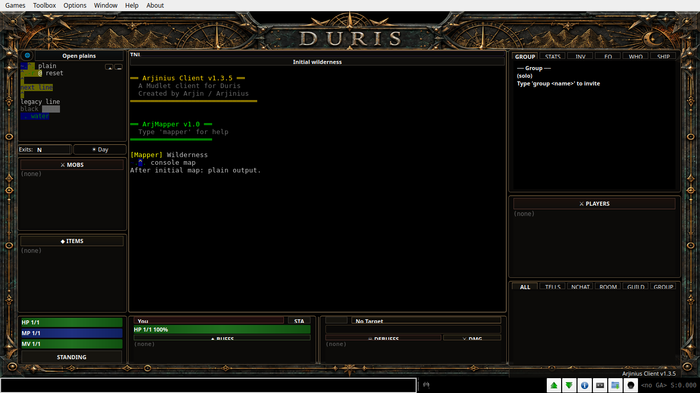
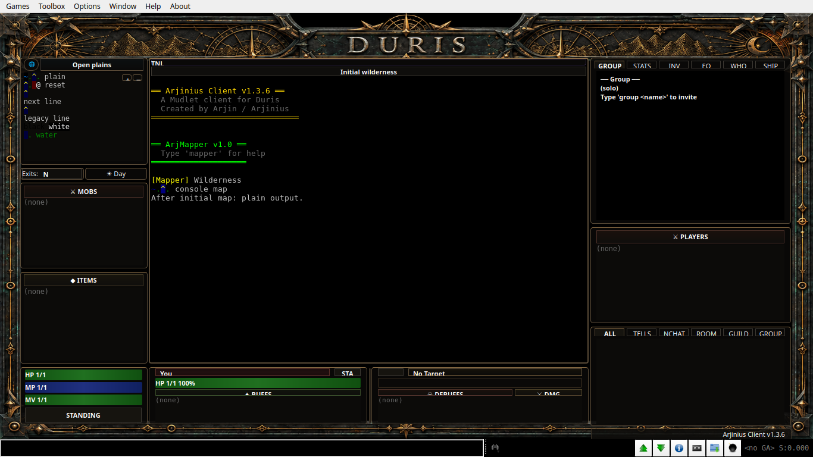

# Wilderness map color bleeding — issue #2

Verified 2026-10-22. [Issue #2](https://github.com/LuminariMUD/duris-client/issues/2)
reports Mudlet 4.22.0 / package 1.3.5. The defect is reproduced with diagnostic
map data in that Mudlet version and fixed in package 1.3.6.

## Cause and change

The server's [`AnsiString::set()` and `put_ansi()`](https://github.com/LuminariMUD/Duris/blob/ca548bae11cab98490fd5e4e954785630b3a07da/src/net/ansi.c)
define `&=XY` as **background X, foreground Y**. The client parsed the two
letters in reverse. Foreground-only `&+X` also replaces the full color
attribute, clearing any background; the client retained the previous one.
Thus `&=bB &+g.` (water followed by plains, using actual server glyphs)
incorrectly painted the plains with the water background. This explains a
reproducible map-panel defect consistent with the report; the screenshot's
exact original payload and route are unavailable.

The mapper now follows those rules, supports background-only `&-X`, and
distinguishes black `l` from bright black `L`. It resets on LF, legacy escaped
newlines, explicit resets and map boundaries, and ignores CR like the server.
The existing muted background palette remains. No server changes are needed.

## Runtime proof

Both archives were imported into fresh **real Mudlet 4.22.0** portable
profiles, opened with the connection dialog's **Offline** button. No 5.x
`--offline` or XDG isolation assumption was used. The same test companion and
9 pt diagnostic map font were used at 1366×768, scale 1. Environment:
Ubuntu 24.04.4 / WSL2, Xvfb, Qt 6.9.0, Consolas resolved to DejaVu Sans Mono.
The official Linux AppImage archive's checksum and exact candidate/source/
fixture identities are in [evidence.json](../testing/issue-2/evidence.json).
The temporary 4.x driver reused the controller's import/checkpoint/capture
functions after manual offline startup; the committed controller still
requires Mudlet 5.0+.

- **Baseline 1.3.5: expected FAIL.** The rendered ocean foreground assertion
  fails, with yellow/blue blocks spilling onto later terrain and the next
  line. [Assertion results](../testing/issue-2/baseline-results.json).
- **Fixed 1.3.6: PASS.** All 23 checks pass, including background/foreground
  order, water-to-plains transition, background-only/default foreground,
  black, resets and line boundaries. Movement and `look` GMCP updates replace
  the map without retaining color; subsequent ordinary console output stays
  black. [Assertion results](../testing/issue-2/fixed-results.json).
- The fixed profile shut down normally, with no Lua errors. The initial,
  movement, `look`, and Errors-view screenshots were inspected.

Before (1.3.5):



After (1.3.6), using the same diagnostic input:



Also reviewed: [movement](../testing/issue-2/movement-4.22.png),
[`look`](../testing/issue-2/look-4.22.png), and
[clean Errors view](../testing/issue-2/errors-4.22.png).

## Repeatable checks and limits

```bash
python3 build.py --check
python3 build.py
python3 -m unittest discover -s tests/mudlet -p 'test_*.py'
python3 -m unittest discover -s tests/release -v
python3 scripts/release.py --output /tmp/duris-issue-2-release
python3 scripts/mudlet_suite.py
python3 scripts/mudlet_test.py run --scenario map-colors --size 1280x720
python3 scripts/mudlet_test.py run --scenario map-colors --size 1920x1080
python3 scripts/mudlet_test.py run --scenario map-colors --scale 2 --size 2732x1536
```

All passed: Lua 5.1 syntax, XML/build and committed package payload validation,
8 controller tests, 15 release tests, and all **20** suite expectations in
Mudlet 5.0.1 / Qt 6.11.1 (including deliberate failures and cleanup). The
suite's 1366×768 map-color checkpoints and Errors view were inspected.
The final expanded 23-check color fixture also passed at 1280×720,
1920×1080 and simulated scale 2 / 2732×1536; initial-map and Errors-view
captures were inspected at each size, plus movement at 1920×1080.
All runs used the same package payload, SHA-256
`70851cbdb5cf87cb5caaeebc98013318123d10e7b7c61c1349b46aeb1396d4bf`;
ZIP timestamps can differ between builds.

Movement/`look` are **synthetic GMCP redraws**, with representative ANSI text
in the main console. They do not establish a live wilderness session or the
reporter's exact route. Mudlet 4.19.1, Windows/macOS and physical desktop DPI
are **NOT RUN**. Hosted CI is separate from this local evidence.
